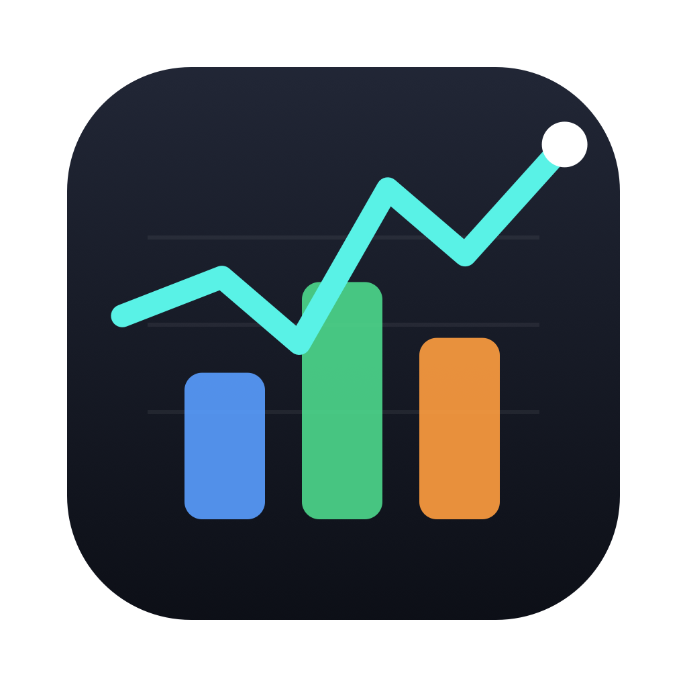
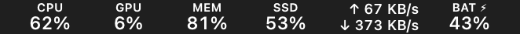
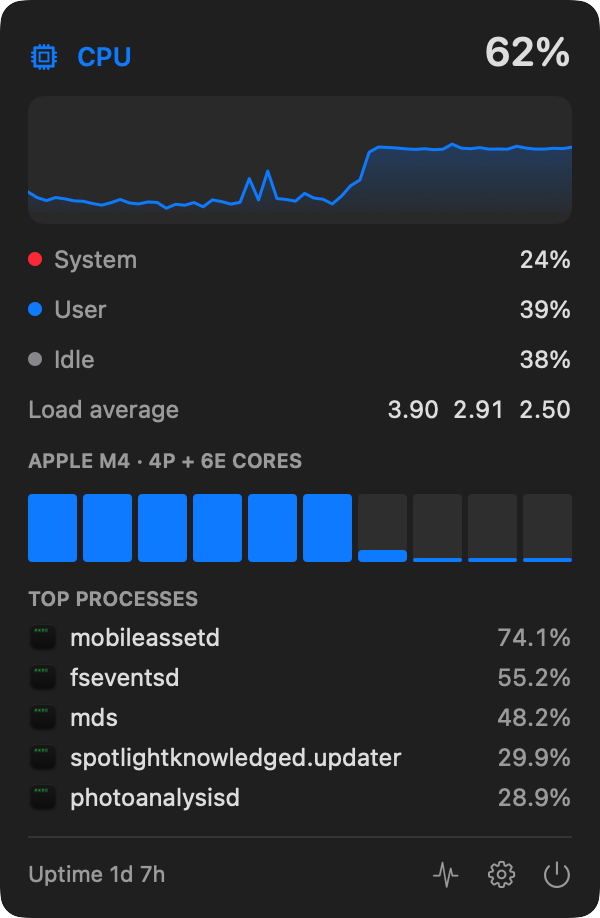
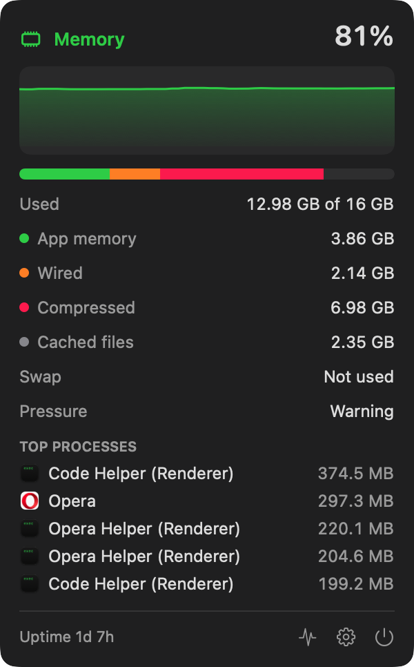
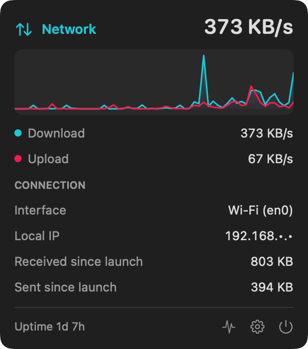
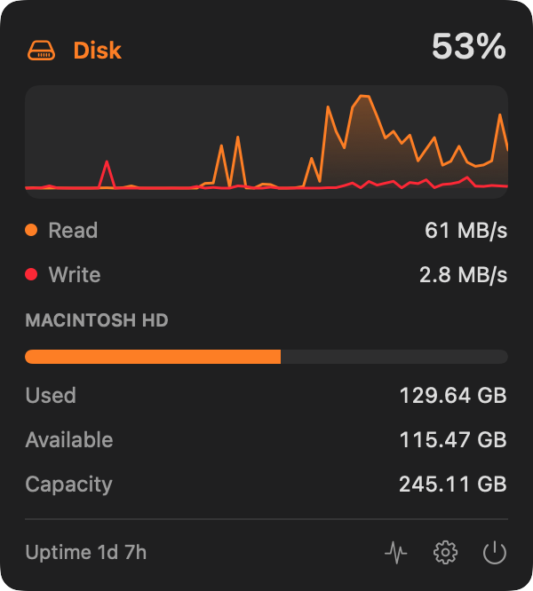
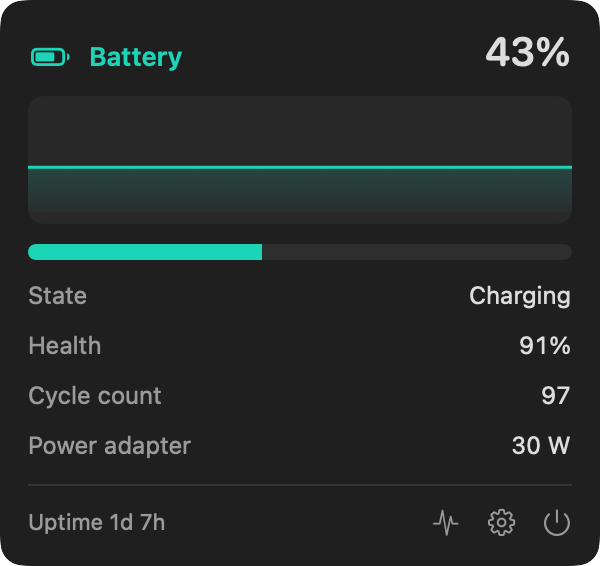
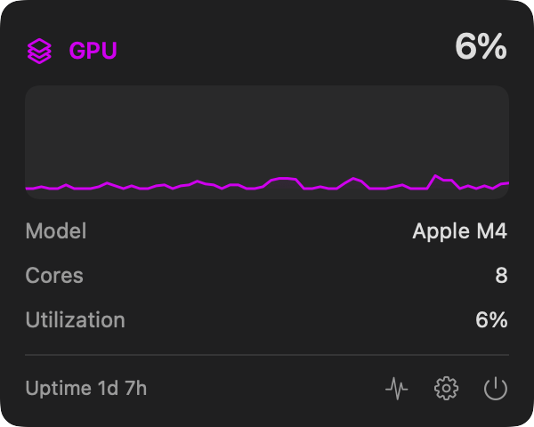

<p align="center">
  
</p>

<h1 align="center">Readout</h1>

<p align="center">
  A lightweight system monitor that lives in your Mac's menu bar.<br>
  CPU, GPU, memory, disk, network and battery, live and at a glance.
</p>

<p align="center">
  
  
  
  
</p>

<p align="center">
  
</p>

## Features

Each module sits in the menu bar on its own. Click one to open a detail panel with a 60-sample live chart.

| Module | In the menu bar | In the panel |
| --- | --- | --- |
| **CPU** | Total usage | System / user / idle, load average, per-core bars, performance and efficiency core counts, top 5 processes |
| **GPU** | Utilization | Model, core count, utilization history |
| **Memory** | Used % | App, wired, compressed and cached memory, swap, memory pressure, top 5 processes |
| **Disk** | Used % of the startup disk | Live read and write speed, used, available and total space |
| **Network** | Upload and download speed | Active interface (Wi-Fi, Ethernet, VPN), local IP, data sent and received since launch |
| **Battery** | Charge % (⚡︎ while charging) | State, time remaining, health, cycle count, power adapter wattage |

It also has:

- **Two menu bar styles:** a small label above the value, or an SF Symbol next to the value.
- **Fixed-width readouts**, so the menu bar doesn't shift around as numbers change.
- **Light and dark menu bars:** everything is drawn as a template image and tinted by macOS.
- **Adjustable refresh rate** of 1, 2, 3, 5 or 10 seconds.
- **Open at login** through the system's login items.
- **Hide local IP address**, for screen sharing and recordings.
- **Low overhead:** process lists are only collected while a panel that shows them is open.
- **No network access, analytics or helpers.** Readout reads public macOS APIs and nothing leaves your Mac.

## Screenshots

<p align="center">
  
  
</p>
<p align="center">
  
  
</p>
<p align="center">
  
  
</p>

## Install

Readout builds with the Swift compiler from Apple's Command Line Tools, so you don't need Xcode.

```bash
xcode-select --install          # only if you don't have the Command Line Tools yet
git clone https://github.com/adamly218/Readout.git
cd Readout
./build.sh --install            # builds a universal app and copies it to /Applications
```

Run `./build.sh` without `--install` to build only `build/Readout.app`.

When it first launches, Readout shows CPU, Memory and Network. To choose modules, open **Settings** from the gear in any panel, or open the app again from Applications.

## Usage

- **Click** a readout to open its panel. Click anywhere else to close it.
- **⌘-drag** a readout to change its place in the menu bar.
- The panel footer shows uptime and has buttons for **Activity Monitor**, **Settings** and **Quit**.

### Command line

The app binary has two extra modes:

```bash
# Print one reading of every module
build/Readout.app/Contents/MacOS/Readout --dump

# Render the panels and menu bar strip to PNG files (used for this README)
build/Readout.app/Contents/MacOS/Readout --snapshot docs
```

## How it works

Every reader uses a public macOS API. There is no kernel extension, no privileged helper and no SMC access.

| Metric | Source |
| --- | --- |
| CPU | `host_processor_info` tick counters, compared between samples |
| Memory | `host_statistics64`, split the same way as Activity Monitor (used = app + wired + compressed) |
| GPU | `PerformanceStatistics` of the `IOAccelerator` service in the IORegistry |
| Disk | Volume resource values for capacity, and `IOBlockStorageDriver` statistics for throughput |
| Network | 64-bit interface counters from `sysctl` (`NET_RT_IFLIST2`) on the primary interface |
| Battery | IOKit power sources and the `AppleSmartBattery` service |
| Processes | One `ps` snapshot per refresh, taken only while the CPU or Memory panel is open |

### Project layout

```
Sources/
  Readers.swift    data models and one reader per module
  Monitor.swift    sampling loop, history, preferences, formatting
  StatusBar.swift  menu bar rendering and popovers
  Views.swift      SwiftUI panels and the Settings window
  main.swift       app delegate and command-line modes
icon/              app icon generator (swift icon/make-icon.swift)
build.sh           build, sign and optionally install
```

## FAQ

**The readouts don't appear in the menu bar.**
Newer versions of macOS make apps ask before they can show menu bar items. Open **System Settings → Menu Bar** and turn **Readout** on. On a MacBook with a notch, items can also be hidden behind it when the menu bar is full.

**Why does free disk space differ from `df`?**
Readout shows the same "available" figure as Finder, which counts purgeable space that macOS can free up when it needs to.

**How do I remove it?**
Quit Readout from any panel and delete `/Applications/Readout.app`.

## License

[MIT](LICENSE) © 2026 adamly218
